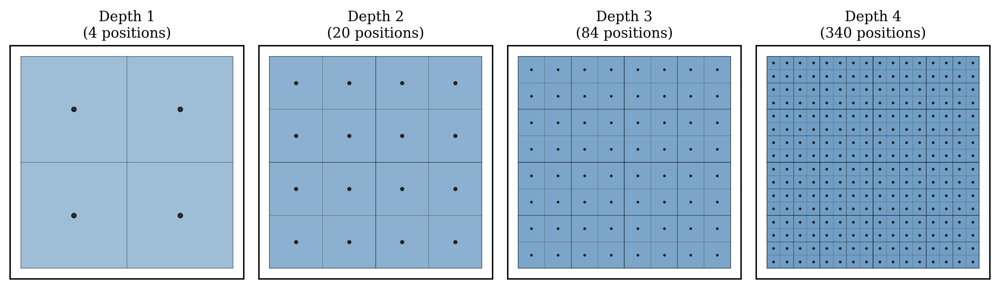
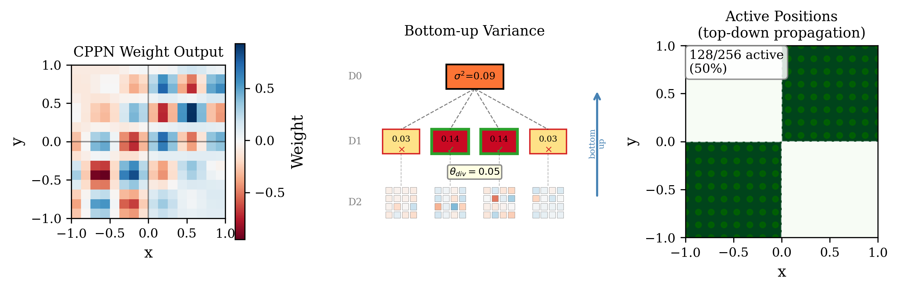
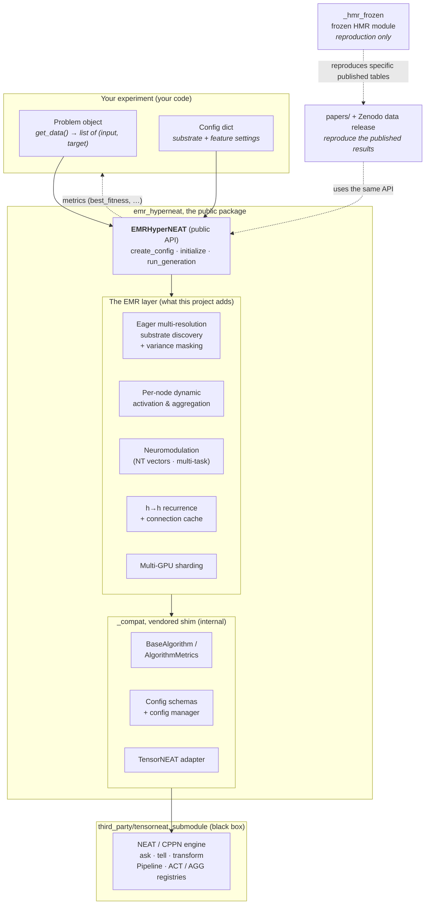

# Architecture

EMR-HyperNEAT is a **layer on top of TensorNEAT**, not a fork of it. TensorNEAT provides the
NEAT/CPPN engine (evolving a genotype network and querying it); EMR-HyperNEAT adds everything needed
to turn that engine into a fast adaptive-substrate neuroevolution system. This page explains the
layer the project adds and how the modules fit together. TensorNEAT internals are treated as a black
box that you never call directly.

## What EMR-HyperNEAT adds

ES-HyperNEAT decides *where to place neurons* by recursively subdividing space with a sequential
quadtree driven by CPPN-output variance. That quadtree is serial and CPU-bound, which caps the
method at small substrates. EMR-HyperNEAT replaces it with:

- **Eager multi-resolution substrate discovery**: a pre-computed hierarchical grid (4^(level+1)
  candidate positions per level) is evaluated all at once as batched tensor arithmetic that `vmap`s
  across the whole population, instead of one quadtree per genome.
- **Post-hoc variance masking**: after the eager evaluation, a variance threshold keeps only the
  informative positions, producing a sparse active substrate equivalent to what the quadtree would
  have found.

<p align="center">
  
</p>
<p align="center"><em>The eager grid. Candidate positions densify with depth (4, 20, 84, 340 positions at depths 1 to 4). Every position is evaluated in one batched pass, rather than being reached by sequential subdivision.</em></p>

<p align="center">
  
</p>
<p align="center"><em>Variance masking recovers the sparse substrate. The CPPN weight field (left) is reduced to per-region variance (center), and regions above threshold stay active (right), reproducing what the quadtree would have kept.</em></p>

On top of that substrate engine, the same package adds four evolvable *feature dimensions*:

- **Per-node dynamic activation functions**: each node can use a different activation, selected
  from an 18-function palette (see [configuration](configuration.md)). This is the single biggest
  lever for parity-style problems.
- **Per-node aggregation functions**: how a node combines its inputs (sum/mean/min/max/…): one
  function for every node, or per node from the CPPN or the incoming weights (see
  [configuration](configuration.md)).
- **Neuromodulation**: neurotransmitter vectors `[DA, 5HT, NE, ACh]` modulate node behavior, which
  enables one substrate to solve several tasks (multi-task).
- **Hidden-to-hidden recurrence** with a connection cache, for tasks that need memory.

Plus engineering for scale: a JIT cache, an h→h connection cache, and optional multi-GPU sharding.

## How a generation is computed

One generation takes the population from CPPN genomes to fitness values in six steps. Steps 2–4 are
the substrate discovery EMR replaces relative to ES-HyperNEAT; steps 1 and 6 are plain NEAT,
delegated to TensorNEAT.

1. **Ask.** TensorNEAT emits the generation's CPPN population and transforms each genome into
   query-ready arrays.
2. **Query the grid.** The candidate substrate is a pre-computed multi-resolution grid: level *l* is
   a `2^(l+1) × 2^(l+1)` lattice of `4^(l+1)` cells, and each level-*l* cell maps to four children at
   level *l+1* (340 candidate positions in total at `max_depth: 3`). For every (genome, source
   node, candidate position) triple the CPPN is evaluated on the input vector
   `[x1, y1, x2, y2, bias]` — a 7-input variant that adds the source→target offsets when geometry
   seeding is enabled. The whole query is one batched tensor computation `vmap`ped across the
   population; nothing is sequential per genome.
3. **Mask by variance.** Within each region of the grid, the variance of the CPPN's output field
   decides whether that region carries structure. Regions below `variance_threshold` are dropped,
   and what survives is the sparse **active set** — the substrate the sequential quadtree would have
   discovered, found by filtering the eager evaluation instead of by recursive subdivision
   (`initial_depth` can force the first levels fully active regardless of variance).
4. **Build the weight matrices.** The substrate is materialized as two dense matrices:
   `W1` with shape `(num_inputs, num_positions)` and `W2` with shape `(num_positions, num_outputs)`.
   Dense is deliberate: input→hidden and hidden→output remain GPU-efficient matmuls even though
   variance masking zeroes most positions.
5. **Evaluate.** The feedforward pass is two lines: `h = tanh(inputs @ W1)`, then
   `sigmoid(h @ W2)`. Per-node dynamic activations and aggregations replace the fixed `tanh` when
   enabled, and neuromodulation multiplies in per-node gains and gates (one rule on every path,
   `neuromodulation.node_rule`) — a *parametric* modulation
   on top of the *structural* choice the dynamic functions make; the two are orthogonal and
   composable. With recurrence, hidden→hidden is the hybrid part of the architecture: h→h
   connections are **sparse** (discovered per genome over the active set), assembled once into a
   `Whh` matrix and applied as a matmul inside `activate_time` settling steps, while W1/W2 stay
   dense. Each step applies the node's whole feed-forward transformation to the input drive plus
   the recurrent input, `h = f(drive + h @ Whh)` from `h = 0`, so without h→h connections the
   recurrent path computes the feed-forward one
   ([configuration](configuration.md#feature-1-dynamic_functions-per-node-activation); in
   0.1.0 its default applied no configured activation). One per-genome function serves both the
   population's fitness and `evaluate_on_data`, so a held-out score is computed on the network that
   was evolved.
6. **Tell.** Per-genome fitness goes back to TensorNEAT's NEAT, which selects, speciates, and
   mutates the CPPNs for the next generation.

### The substrate on its own

Steps 2 to 5 of the feed-forward standard path are public functions in `emr_hyperneat.substrate`,
for tools that need the substrate rather than a fitness: to draw it, to render what it computes,
or to run it on other inputs. The generation loop builds and evaluates its substrate through the
same functions, and `tests/test_substrate_api.py` checks bit for bit that the public calls return
the arrays and fitness the loop computes.

```python
algo = EMRHyperNEAT()
cfg = algo.create_config(params)
state = algo.initialize(cfg, problem)
substrate = algo.population_substrates(state)   # W1, W2, mask, per-node indices per genome
outputs = substrate_forward(substrate, inputs)  # (pop, samples, outputs)
```

A tool with its own CPPN evaluator takes the query rows from `substrate_queries(config)`,
evaluates them, and passes the outputs to `build_substrate`. The evaluator must compute exactly
what the model's CPPN computes, output transform included.

Hidden-to-hidden connections take two more steps, the caller evaluating the CPPN again:
`hh_query_rows(substrate)` gives, per genome, the rows of every ordered pair of its active
positions (sources and targets in ascending position order, source-major), and
`build_recurrent_substrate(substrate, hh_outputs)` turns the outputs into the generation loop's
connections: `hh_from`, `hh_to`, `hh_weights`, `hh_valid` in the loop's layout of
`max_sparse_conns` slots, plus `hh_class` (forward, lateral, backward or self, by the
positions' y), `hh_direct` (a direct connection at its own weight, not a composite of the
multi-hop expansion) and `hh_uncapped` (connections before the cap). The build runs the loop's
per-genome discovery arithmetic (`per_genome_pair_connections`, with the band criterion
`hh_pair_weights`) on the loop's bucket shapes, so its connections are the loop's bit for bit,
and one genome built alone gives the arrays it has in its population. `substrate_forward`
settles each genome on its own active positions with the loop's node function, and
`return_states=True` also returns the hidden state after each settling step, one array per
genome over its own positions. It settles `SubstrateConfig.activate_time` steps (None:
`2 (2**max_depth + 1)`), the count the configuration names in either block; a count that is not an
integer of at least 1 is refused there as in the configuration, and a feed-forward substrate ignores
it. The loop evaluates a recurrent population on the union of its
active positions, so the forward matches the loop's fitness within float32 rounding, not bit for
bit; on a GPU the two layouts round differently and a settling that amplifies rounding can move
a genome's fitness by more (`tests/test_substrate_recurrent.py`). A genome whose mask a caller
has cleared entirely has no hidden node: `(0, input_dim)` rows, no connections, settling states
of width 0, and the outputs the feed-forward forward gives with every column zeroed (the output
activation of zero). A mask the library builds always keeps the four positions of the coarsest
level.

Neuromodulation, multi-task, swarm mode, the weight-interpretation and random function modes,
the union h->h discovery, dense discovery and the h->h cache are outside the API's scope, and
`substrate_config` refuses them.

### The recurrent path: multi-hop expansion and the h→h cache

Direct h→h connections come from thresholded CPPN queries over pairs of active positions.
`iteration_level` *k* then expands them transitively by repeated matrix products. With A the
genome's direct connections (the masked adjacency), the engine forms the hop terms decay^(h−1)·A^h
for h = 1..k and keeps, per pair, the term of largest magnitude (a max merge, not a sum, so a strong
direct connection is never replaced by a weaker indirect one); each product is thresholded at the
band before the decay, and the result is clipped to `max_weight`:

```
A_total[i,j] = the largest-magnitude term among A[i,j], decay·A²[i,j], …, decay^(k−1)·A^k[i,j]
```

so that if A→B and B→C exist, an attenuated A→C is added (`hop_decay_factor` is the decay), and the
expanded set is intersected with the preset's connection class, so a composite that would land in a
class the preset forbids is dropped. Every hop is an existing direct connection
(`recurrence.multi_hop_second_factor: masked`, the default since 0.2.0). The expansion is
JIT-compatible because *k* and the second factor are static arguments, so the Python loop compiles
away.
Discovery is the expensive step, so it can be cached at two levels: JAX's persistent compilation
cache (cross-run, keyed on shapes), and the in-run `HHCacheManager` (off by default since 0.2.0),
which skips re-discovery while the variance mask is stable and refreshes every
`hh_refresh_interval` generations or when the mask moves by more than `hh_mask_change_threshold`.
The in-run cache changes what is evaluated, not only how fast: its connection set is indexed by
population slot, and reproduction moves genomes between slots, so between refreshes a genome is
scored with the recurrent connections discovered for whichever genome held its slot at the last
refresh. That is why it is off by default; `hh_cache_enabled: true` reproduces a cache-on run (see
[configuration](configuration.md)). A cache keyed by genome
content would be sound but would only serve genomes unchanged since the last discovery (the elites),
a few percent of a NEAT population, so it would recover almost none of the time; the saving the
slot cache produced came from skipping discovery for genomes that had changed. Discovery itself is
where the cost sits (80 to 90% of a cache-off generation at depths 2 to 6 on XOR at population 1000
on an RTX 2080 Ti, with the union query). The union query evaluates the CPPN over the population's
union of active positions, so a per-genome or bucketed query is the result-preserving way to make it
cheaper. `recurrence.hh_discovery_mode: per_genome`, the default, buckets the genomes by their
active-position count into static sizes (8, 16, 32, ...) and evaluates each bucket's CPPNs over
the genomes' own position pairs in slices of a fixed number of genomes per bucket size (at most 2^16
pairs per call; a short slice is padded with a repeated member whose rows are dropped at the
scatter), the whole population in one call, so each bucket size compiles once per run. From bucket
size 1024 on, a slice's query runs over blocks of source positions in sequence (at most 2^18 pairs per
block), so one call's temporaries stay near 120 MB instead of growing with the square of the bucket
(1.9 GB at 2048). It returns the
union path's connections and weights at every level (bit for bit on a CPU at level 1, and at level 2
across 36 configurations; a GPU fuses the same per-pair arithmetic
differently by batch shape and lands 1 to 6 float32 ulps away at level 1, up to about 28 against the
reference formula at level 3, with identical connection sets; the criterion stays "same connections,
weights within a few ulps"). In 0.1.0 the union implementation
computed each hop as `A_current @ W` with `W` the raw weights over the whole union of active
positions rather than the masked `A`, so a genome's 2-hop connections could end on positions it did
not have active, run against its connection class, and change with the other genomes in the
population (on XOR at depth 3 with 30 genomes, 78% of the level-2 connections left the genome's
active set), and it carried the decayed product into the next hop (hop 3 at decay³ instead of
decay²). Since 0.2.0 both query modes compose the masked `A` on every hop;
`multi_hop_second_factor: raw` reproduces 0.1.0's expansion bit for bit and is refused together with
`per_genome` (faster than union at every depth 1 to 7 on XOR, population 1000, an RTX 2080 Ti, with
identical results). After every discovery
call the module-level `emrhyperneat._last_discovery_stats` holds per-genome direct and total
connection counts, the direct connections whose weight the merge replaced, each genome's count
before the `max_sparse_conns` cap and what the cap dropped, active positions and the union size,
for experiment records; the generation's metrics read the truncation counts from it. The pmap pipelines (multi-GPU
strategies) keep their own inline discovery of direct connections, at `iteration_level` 1 only:
since 0.2.0 it applies the connection class like the standard path, and both pmap runners refuse a
level above 1 and the features their tanh/sum evaluation drops on entry (in 0.1.0 a level-2 preset
ran there as level 1 while `effective_iteration_level` recorded 0), recording `effective_iteration_level`
1. Level 0 runs there as level 1, as on the standard path; 0.2.0 passed it on as 0, which these
pipelines read as feed-forward (no hidden-to-hidden connection) while recording level 1. The check
runs at dispatch because the same configuration falls back to the standard path on one device or on
a dataset under 16 rows per device, where level 2 is computed.

### Why the three execution modes compute the same thing

The execution modes never change *what* is computed — only where the intermediate arrays live.
(This holds under either `variance_rule`. Under `legacy`, which the EMR paper runners pin,
streaming and depth_offload apply the standard path's original level-0 rule; in 0.1.0 they ran the
canonical rule instead.)

- **`standard`** queries every candidate position at once. Fastest, highest peak memory, and the
  path the golden tests lock.
- **`streaming`** builds the weight matrices level by level, so only one level's queries are
  resident at a time — roughly 3–10× slower per generation, and the difference between running
  depth 8+ and running out of memory.
- **`depth_offload`** additionally keeps the assembled matrices in host RAM (or a memmap) and moves
  each chunk to the device only to evaluate it. It is the only mode that reaches depth 11+, where
  the matrices exceed device memory outright.

`streaming` swaps one step inside the normal generation loop, so it composes with everything else
the loop does. `depth_offload` cannot: never materializing the full matrices means its build and its
evaluation are fused, so it replaces the generation rather than a step within it. That asymmetry is
why the dispatcher has two extension points rather than one. Knobs and auto-selection rules:
[configuration](configuration.md#execution-mode).

### What the multi-GPU strategies parallelize

Multi-GPU execution engages **only through `run_until_threshold`** (`run_generation` is
single-device by design), and only with 2+ visible devices. Each strategy answers one question:
what is split across the GPUs, and what is replicated on each?

| Strategy | Split across GPUs | Replicated per GPU | Use when |
|---|---|---|---|
| `single_gpu` | nothing | everything | one device, debugging, small runs |
| `full_pipeline_parallel` | the **dataset** | population + the full pipeline | the feedforward default. Auto-disabled when `problem.is_exhaustive_dataset` is true, because combinatorial tasks (XOR, parity) need every sample evaluated together. With hidden-to-hidden connections it runs `iteration_level` 1 only and refuses a higher level |
| `eval_only_parallel` | evaluation samples | weights (broadcast) | recurrent/h→h runs: discovery and W1/W2 stay on one device so the h→h cache survives |
| `population_parallel_process` | the **population** (one OS process per GPU, each with its own JAX runtime) | the dataset | **not recommended.** The least exercised path here; development measurements made outside this repository found it far slower than single-device and returning zero best fitness at large populations, and they are not reproducible from this repository |
| `streaming` | data streamed CPU→GPU in chunks | — | datasets larger than combined device memory |

The parser also accepts nine older alias names and maps them onto these five:
`multi_gpu`, `data_parallel`, `pipeline_chunked` and `position_sharding_chunked` become
`full_pipeline_parallel`; `pmap_parallel` becomes `eval_only_parallel`; `cppn_chunked` becomes
`streaming`; `population_parallel_sequential` and `persistent_parallel` become
`population_parallel_process`; `baseline` becomes `single_gpu`. The constructor's `strategy`
argument maps the same names the same way (`STRATEGY_NAME_MAP` in `emr_hyperneat.emrhyperneat`),
and the other `MultiGPUStrategy` members, which name base-class strategies this class has no route
for, raise. In 0.1.0 only `streaming`, `eval_only_parallel` and `population_parallel_process` kept
their multi-device route through the constructor: it mapped `full_pipeline_parallel`, `multi_gpu`,
`data_parallel` and `cppn_chunked` to strategies without one and kept the other aliases as they
were, so such a run took the one-device loop under the requested name.

Speed is deliberately absent from this table. The per-strategy ratios that used to sit in the
code's docstrings traced to a development note with no result file behind them, and later
measurements disagreed with them. Pick by the memory and correctness columns, then measure on your
own hardware.

## Component diagram



Data flows down (your problem + config → the API → the EMR layer → the shim → TensorNEAT); fitness
metrics flow back up to your loop. `_hmr_frozen` and the data release sit to the side. You only
touch them when reproducing older results.

## Module map

Everything is under `emr_hyperneat/`.

### Public: what you import and call

| Module | Role |
|---|---|
| `__init__.py` | The public surface: `EMRHyperNEAT` and the substrate API below. |
| `substrate.py` | The substrate outside the generation loop, feed-forward or with hidden-to-hidden connections: `SubstrateConfig`, `substrate_queries`, `query_substrate`, `build_substrate`, `substrate_forward`, `hh_query_rows`, `build_recurrent_substrate`, `query_recurrent_substrate`. See [The substrate on its own](#the-substrate-on-its-own). |
| `emrhyperneat.py` | The `EMRHyperNEAT` class and the feature layer: per-node dynamic activation/aggregation, neuromodulation, multi-task, the h→h cache, and the config dataclasses. Also defines `ACTIVATION_LIST` (the 18 activations) and `PALETTE_CONFIGS`. |
| `emrhyperneat_base.py` | The engine beneath the class: eager multi-resolution substrate discovery, recurrence/cache config, multi-GPU sharding, and the **TensorNEAT integration seam**. |
| `execution/` | The three execution modes — how a generation moves its intermediate arrays through memory. `ExecutionMode` and `ExecutionConfig` in `__init__.py`, memory arithmetic in `chunking.py`, and the two non-standard strategies in `streaming.py` and `offload.py`. See [Configuration](configuration.md#execution-mode). |
| `fitness_utils.py` | Ready-made fitness functions (binary / multi-class / regression) for benchmarks. |
| `multi_gpu_worker.py` | Worker processes for true multi-GPU runs (each owns its JAX runtime). Not needed for single-device use. |

You construct `EMRHyperNEAT()` and call its methods (see
[Writing experiments](writing-experiments.md)); the substrate functions are for inspecting what
it evolves.

### Internal: you do not import these directly

| Module | Role |
|---|---|
| `_compat/` | A small vendored **compatibility shim** that keeps the package self-contained: it provides `BaseAlgorithm` + `AlgorithmMetrics` (the base class and the metrics object), the Pydantic config schemas, the **TensorNEAT adapter**, and the config/parameter manager. No external framework is required. |
| `_hmr_frozen/` | A **frozen module** that some paper runners import to reproduce specific published tables exactly. It is bit-for-bit equivalent to EMR on the shared paths when EMR is pinned to `variance_rule: legacy` (the package default is `canonical`) and is given no `neat_*` settings (the frozen module keeps its own NEAT defaults); it is not part of the public API — never call it from your own code. Which runners use it: [reproducing experiments](reproducing-experiments.md#which-experiments-use-which-engine). |
| `tests/` | The test suite (see [Testing](testing.md)), including `test_paper_validation.py`, which re-runs the simple paper experiments. |

## The TensorNEAT seam (the black box)

EMR-HyperNEAT reaches TensorNEAT through exactly two narrow seams, both inside the package internals:

1. The `_compat` **adapter** (`_compat/adapters/tensorneat_adapter.py`) builds the NEAT algorithm and
   its config and pulls TensorNEAT's activation/aggregation registries.
2. The **engine** (`emrhyperneat_base.py`) lazily imports TensorNEAT's HyperNEAT genome pieces, the
   `RecurrentGenome` (whose `forward` is the CPPN query), and the `Pipeline` driver, then JIT-compiles
   the ask/transform/tell cycle — steps 1 and 6 of [how a generation is computed](#how-a-generation-is-computed).

Everything the project adds (the eager grid, variance masking, batched CPPN queries across the
population, dynamic per-node functions, neuromodulation, and the caches) lives above this seam. You
do not need to understand NEAT or CPPNs to use EMR-HyperNEAT; you configure the substrate and the
feature dimensions, and the engine does the rest.

Next: [Writing experiments](writing-experiments.md) to use the API, or the
[configuration reference](configuration.md) for every knob.
