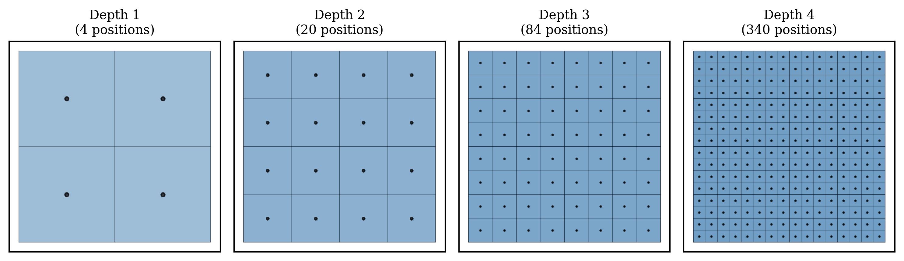
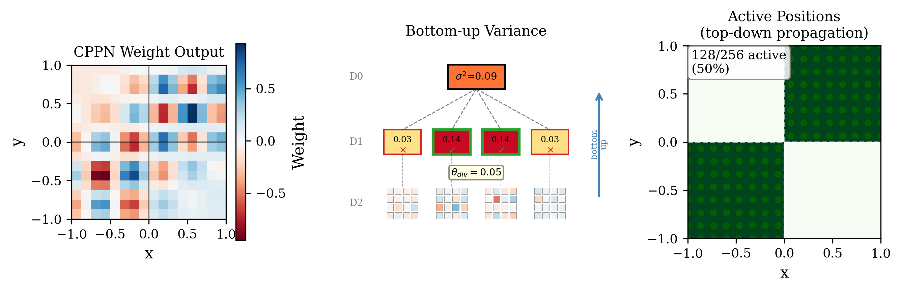
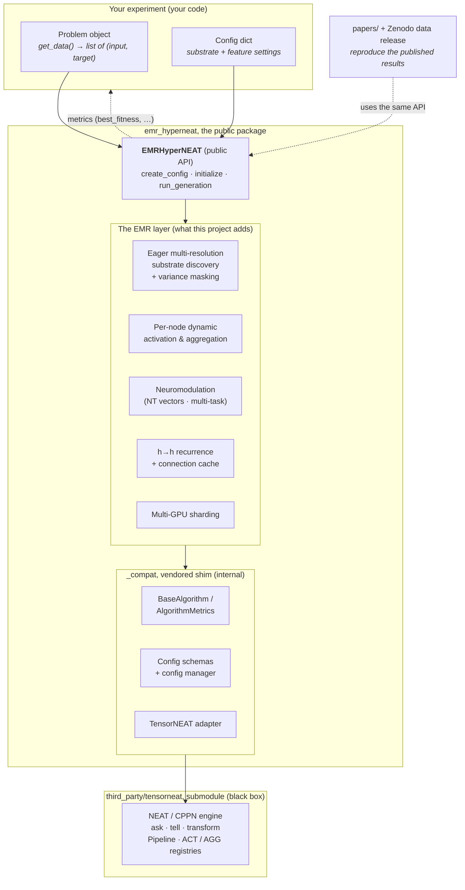

# Architecture

EMR-HyperNEAT is a **layer on top of TensorNEAT**, not a fork of it. TensorNEAT provides the
NEAT/CPPN engine (evolving a genotype network and querying it); EMR-HyperNEAT builds the adaptive
substrate from those queries and evaluates it. This page explains the
layer the project adds and how the modules fit together. TensorNEAT internals are treated as a black
box that you never call directly.

## What EMR-HyperNEAT adds

ES-HyperNEAT decides *where to place neurons* by recursively subdividing space with a sequential
quadtree driven by CPPN-output variance. That quadtree is serial and CPU-bound, which caps the
method at small substrates. EMR-HyperNEAT replaces it with:

- **Eager multi-resolution substrate discovery**: a pre-computed hierarchical grid (4^(level+1)
  candidate positions per level) is evaluated all at once as batched tensor arithmetic that `vmap`s
  across the whole population, instead of one quadtree per genome.
- **Post-hoc variance masking**: after the eager evaluation, a cell below the top level is reached
  when its parent was reached and the variance of the CPPN outputs over the parent's four children
  passes a threshold (under the default `variance_rule: canonical`), the gate ES-HyperNEAT's
  quadtree applies. Every reached cell, at every level, is a node. The position sets can still
  differ: the mask reads the first input's CPPN outputs, where ES-HyperNEAT grows one tree per
  input; EMR's variance threshold (0.03) applies to raw CPPN outputs, ES-HyperNEAT's (0.5) to
  weights scaled to [-5, 5]; and EMR keeps connections by weight magnitude rather than by
  ES-HyperNEAT's band test.

<p align="center">
  
</p>
<p align="center"><em>The eager grid. Candidate positions densify with depth (4, 20, 84, 340 positions with 1 to 4 levels, that is max_depth 0 to 3). Every position is evaluated in one batched pass, rather than being reached by sequential subdivision.</em></p>

<p align="center">
  
</p>
<p align="center"><em>Variance masking selects the sparse substrate. The CPPN weight field (left) is reduced to per-region variance (center), and regions above threshold stay active (right).</em></p>

On top of that substrate engine, the same package adds four evolvable *feature dimensions*:

- **Per-node dynamic activation functions**: each node can use a different activation, selected
  from an 18-function palette (see [configuration](configuration.md)). Oscillatory activations such
  as `sin` solve feed-forward parity beyond XOR, which monotonic activations almost never do: on
  Parity-4, `sin` reaches the 0.95 threshold in 30 of 30 runs and nine of the ten monotonic
  functions in none (recurrence changes this).
- **Per-node aggregation functions**: how a node combines its inputs (sum/mean/min/max/...): one
  function for every node, or per node from the CPPN or the incoming weights (see
  [configuration](configuration.md)).
- **Neuromodulation**: neurotransmitter vectors `[DA, 5HT, NE, ACh]` modulate node behavior, which
  enables one substrate to solve several tasks (multi-task).
- **Hidden-to-hidden recurrence**: the hidden layer settles for a fixed number of steps on each
  input, from zero every time, so no state carries between inputs (the h->h connection cache is
  off by default).

Plus engineering for scale: a JIT cache and optional multi-GPU sharding.

## How a generation is computed

One generation takes the population from CPPN genomes to fitness values in six steps. Steps 2–4 are
the substrate discovery EMR replaces relative to ES-HyperNEAT; steps 1 and 6 are plain NEAT,
delegated to TensorNEAT.

1. **Ask.** TensorNEAT emits the generation's CPPN population and transforms each genome into
   query-ready arrays.
2. **Query the grid.** The candidate substrate is a pre-computed multi-resolution grid: level *l* is
   a `2^(l+1) × 2^(l+1)` lattice of `4^(l+1)` cells, and each level-*l* cell maps to four children at
   level *l+1* (340 candidate positions in total at `max_depth: 3`). For every (genome, source
   node, candidate position) triple the CPPN is evaluated on the input vector
   `[x1, y1, x2, y2, bias]`, or a 7-input variant that adds the source->target offsets when geometry
   seeding is enabled. The whole query is one batched tensor computation `vmap`ped across the
   population; nothing is sequential per genome.
3. **Mask by variance.** Within each region of the grid, the variance of the CPPN's output field
   decides whether that region carries structure. A reached cell's four children are reached when
   the variance of their outputs passes `variance_threshold` (under the default
   `variance_rule: canonical`); below it the cell stays a node, but its children are not reached.
   What is reached is the sparse **active set**, found by filtering the eager evaluation instead of
   by recursive subdivision; as in the quadtree, a region is reached only through its parent
   (`initial_depth` can force the first levels fully active regardless of variance).
4. **Build the weight matrices.** The substrate is materialized as two dense matrices:
   `W1` with shape `(num_inputs, num_positions)` and `W2` with shape `(num_positions, num_outputs)`.
   Dense is deliberate: input->hidden and hidden->output remain GPU-efficient matmuls even though
   variance masking zeroes most positions.
5. **Evaluate.** The feedforward pass is two lines: `h = tanh(inputs @ W1)`, then
   `sigmoid(h @ W2)`. Per-node dynamic activations and aggregations replace the fixed `tanh` when
   enabled, and neuromodulation multiplies in per-node gains and gates (one rule on every path,
   `neuromodulation.node_rule`), a *parametric* modulation
   on top of the *structural* choice the dynamic functions make; the two are orthogonal and
   composable. With recurrence, hidden->hidden is the hybrid part of the architecture: h->h
   connections are **sparse** (discovered per genome over the active set), assembled once into a
   `Whh` matrix and applied as a matmul inside `activate_time` settling steps, while W1/W2 stay
   dense. Each step applies the node's whole feed-forward transformation to the input drive plus
   the recurrent input, `h = f(drive + h @ Whh)` from `h = 0`, so without h->h connections the
   recurrent path computes the feed-forward one
   ([configuration](configuration.md#feature-1-dynamic_functions-per-node-activation); in
   0.1.0 its default applied no configured activation). One per-genome function serves both the
   population's fitness and `evaluate_on_data`, so a held-out score is computed on the network that
   was evolved.
6. **Tell.** Per-genome fitness goes back to TensorNEAT's NEAT, which selects, speciates, and
   mutates the CPPNs for the next generation.

### The substrate on its own

Steps 2 to 5 of the feed-forward standard path are public functions in `emr_hyperneat.substrate`,
for tools that need the substrate rather than a fitness: to draw it, to render what it computes,
or to run it on other inputs. The generation loop builds and evaluates its substrate through the
same functions, and `tests/test_substrate_api.py` checks bit for bit that the public calls return
the arrays and fitness the loop computes.

```python
algo = EMRHyperNEAT()
cfg = algo.create_config(params)
state = algo.initialize(cfg, problem)
substrate = algo.population_substrates(state)   # W1, W2, mask, per-node indices per genome
outputs = substrate_forward(substrate, inputs)  # (pop, samples, outputs)
```

A tool with its own CPPN evaluator takes the query rows from `substrate_queries(config)`,
evaluates them, and passes the outputs to `build_substrate`. The evaluator must compute exactly
what the model's CPPN computes, output transform included.

Hidden-to-hidden connections take two more steps, the caller evaluating the CPPN again:
`hh_query_rows(substrate)` gives, per genome, the rows of every ordered pair of its active
positions (sources and targets in ascending position order, source-major), and
`build_recurrent_substrate(substrate, hh_outputs)` turns the outputs into the generation loop's
connections: `hh_from`, `hh_to`, `hh_weights`, `hh_valid` in the loop's layout of
`max_sparse_conns` slots, plus `hh_class` (forward, lateral, backward or self, by the
positions' y), `hh_direct` (a direct connection at its own weight, not a composite of the
multi-hop expansion) and `hh_uncapped` (connections before the cap). The build runs the loop's
per-genome discovery arithmetic (`per_genome_pair_connections`, with the band criterion
`hh_pair_weights`) on the loop's bucket shapes, so its connections are the loop's bit for bit,
and one genome built alone gives the arrays it has in its population. `substrate_forward`
settles each genome on its own active positions with the loop's node function, and
`return_states=True` also returns the hidden state after each settling step, one array per
genome over its own positions. It settles `SubstrateConfig.activate_time` steps (None:
`2 (2**max_depth + 1)`), the count the configuration names in either block; a count that is not an
integer of at least 1 is refused there as in the configuration, and a feed-forward substrate ignores
it. The loop evaluates a recurrent population on the union of its
active positions, so the forward matches the loop's fitness within float32 rounding, not bit for
bit; on a GPU the two layouts round differently and a settling that amplifies rounding can move
a genome's fitness by more (`tests/test_substrate_recurrent.py`). A global `softmax` hidden
activation normalizes across the hidden positions, and its definition is the whole grid's at the
configured depth, as the feed-forward forward evaluates it: on a genome's own positions, and in the
loop on a compacted generation's union, each grid position left out has zero weights in and out,
so it adds `exp(c - m)` to the denominator, `c` being the input such a position's softmax receives
at that step and `m` the largest input, and the bucket's padding adds nothing (`full_grid_softmax`).
The evaluation carries one virtual position after its own, settled by the same rule, that stands for
the missing ones: without neuromodulation `c` is 0 under `emr` and at the first step of
`drive_once`, whose later steps add a node's own state to its recurrent input, and under true
neuromodulation it is the node rule's value at a zero drive, from the receptors and base gain
derived there. On populations built as `tests/test_substrate_recurrent_neuromodulation.py` builds
its cases (depth 3, 20 genomes, seed 42, XOR; an Apple M4 Max, jax 0.6.1, single-threaded Eigen)
the API's outputs and the loop's under a global `softmax` are at most 1.8e-7 apart, but for one
genome under `drive_once` with neuromodulation, whose outputs are 1.7e-5 apart. A genome whose mask
a caller has cleared entirely has no hidden node: `(0, input_dim)` rows, no connections, settling
states of width 0, and the outputs the feed-forward forward gives with every column zeroed (the
output activation of zero). A mask the library builds always keeps the four positions of the
coarsest level.

True neuromodulation (level 4) is in the API as the loop runs it, with receptors from the weights,
on a feed-forward substrate and on a recurrent one. `substrate_config` carries the configuration's
settings in `SubstrateConfig.neuromodulation` (a `NeuromodulationSettings`), and `substrate_forward`
then applies the loop's node rule and output inversion, bit for bit on a feed-forward substrate.
`substrate_neuromodulation(substrate)` returns what the nodes read, a `SubstrateNeuromodulation`:
each hidden position's receptor densities and base gain, derived from its first input weight as the
loop derives them, and the neurotransmitter vector (by default the loop's single-task vector,
`default_neurotransmitter`). A caller may build its own, for example from another summary of a
node's weights through `derive_receptor_from_weight`, and pass it as `substrate_forward(substrate,
inputs, neuromodulation=...)`: the loop's rule applies to whatever it is given. Under
neuromodulation the configured output activation applies, as in the loop. An aggregation palette
(`aggregation.palette`, any subset of `AGGREGATION_LIST` in any order) is decoded as the loop decodes
it (`SubstrateConfig.aggregation_palette`).

On a recurrent substrate the node rule applies at every settling step, composed as the generation
loop composes it, its functions unchanged: under `settling_rule: emr` over the settling activation
at every step of `settle_hidden`; under `drive_once` by the additive rule of the prototype's FULL
variant (`settle_hidden_additive`: the node of the input drive with the configured activation,
`tanh` under `hh_activation_mode: tanh`, then `activate_time` steps of `h + node(recurrent(h))` with
`tanh`); then the output activation and the inversion. Each genome reads its receptors and base
gains at its own active positions, gathered with its `W1` and `W2` columns and zero-padded like
them, so a position its mask clears loses them with its connections. The neurotransmitter vector and
the strength are operands of the compiled forward, so changing their values compiles nothing new (a
vector of another length compiles a new program for each bucket size); the channel count, modulation
mode, node rule and inversion are in its key. `return_states` keeps the shape
`(activate_time, samples, count)` under both rules: under `drive_once` the states after the update
steps, the node of the input drive that starts them left out. With `return_states` the outputs come
from the compiled program the call without it runs and the states from a second program that also
emits them, so the outputs never depend on `return_states` (on the CPU they are that call's bit for
bit): with the 18-function palette under `steep_gate` the second program rounds a settling step 1 to
2 ulps apart from the first (an ulp, a unit in the last place, is the gap between adjacent float32
values), even under single-threaded Eigen, and a chaotic genome carried that from fitness 0.750 to
0.504. `states[-1]` through `W2`, the output activation and the inversion reproduces the outputs for
a genome that one ulp of its weights does not move; for a chaotic genome the two programs can
differ. Without neuromodulation the outputs come from the program that returns the states.

What the loop refuses there is refused, by `SubstrateConfig.validate` for a configuration and by the
forward for settings that did not go through it (a caller-built `SubstrateNeuromodulation`, held to
its own settings, or a substrate whose `config` was set with `_replace` or that was built by hand):
under `drive_once`, dynamic h->h aggregation and an `every_iteration` activation other than plain
`tanh` (set `initial_only`); node rule `anti` outside modulation mode `full`, with more than four
channels (the loop refuses them in single-task mode only, whose vector has four entries; on a
recurrent substrate the API refuses them whatever the vector), or with the inversion on. Under `emr`
nothing else is refused: per-node or global activations, h->h aggregation `sum` or `dynamic`, every
preset and class combination, any iteration level (levels 1 to 4 tested), every cap policy and an
explicit step count. Also refused on a recurrent substrate (the dense feed-forward forward checks
neither; the compiled one refuses the strength too, and receptors without the channels the node rule
reads, below): a modulation strength that is not a finite number in float32, the precision the
forward reads it at (NaN would reach the outputs, and 1e40, finite in float64, is inf in float32),
and a receptor derivation that `derive_receptor_from_weight` does not know. On this path the forward
runs `validate` on the configuration first, with configured or caller-built neuromodulation alike,
so a configuration that bypassed it is refused with validate's message: without that call,
`activate_time` 0 would return the node of the input drive under `drive_once` (states of shape
`(0, samples, count)`) where every other path raises, a `settling_rule` typo would run `emr` without
the `drive_once` refusals, and `initial_only` under `emr` would settle through `tanh`. `validate`
only reads the configuration, so a valid one evaluates bit for bit as it would without the call. A
caller-built neuromodulation's settings are held to validate's checks with validate's messages, an
unknown modulation mode or node rule included (on a feed-forward substrate an unknown one keeps that
path's own message). The forward also refuses, naming both shapes, receptors without the channels
the node rule reads (every channel under `anti`, otherwise the first three).

The recurrent forward under neuromodulation matches the loop within float32 rounding, since the loop
evaluates the population on the union of its active positions. On XOR's four rows (an Apple M4 Max,
jax 0.6.1, CPU, `XLA_FLAGS=--xla_cpu_multi_thread_eigen=false`; the 22 configurations of
`tests/test_substrate_recurrent_neuromodulation.py`, depth 3, 20 genomes each, seed 42) the largest
output and fitness differences, by node rule and settling rule, are: `paper` under `emr`, 3.8e-6
(one ulp of a `relu` output of 42.1; 3.0e-7 among bounded outputs) and 6.0e-8; `paper` under
`drive_once`, 9.5e-7 (16 ulps of an output of 0.56) and 3.0e-7; `steep_gate` under `emr`, 1.2e-7 and
6.0e-8; `steep_gate` under `drive_once`, 6.0e-8 and 0; `anti` under `emr`, 1.8e-7 and 6.0e-8; `anti`
under `drive_once`, 6.0e-8 and 0. On a Xeon E5-2683 v4 (jax 0.6.1) the 22 stay within the overall
largest differences above (3.8e-6 in outputs, 3.0e-7 in fitness) under single-threaded Eigen, though
not rule by rule: 1.1e-6 in outputs under `paper` with `drive_once`, 1.2e-7 and 6.0e-8 under
`steep_gate` with `drive_once`. Under XLA's default multi-threaded Eigen 21 of them stay within
those overall maxima there, and the global `sin` configuration's chaotic settling carries the two
programs' rounding to 0.94 in outputs and 0.105 in fitness in 12 of its 20 genomes. On the M4 Max
under XLA's defaults two do not: global `sin`, 0.14 in outputs and 0.041 in fitness, and the
18-function palette under `steep_gate`, 1.0 and 0.25; the loop's outputs are the same under both
settings there, and the API's compiled forward moves. These are measurements on those populations,
not a bound of the forward: a genome whose settling is chaotic carries the rounding to order 1, on
XOR's four rows too. The global `sin` population is mostly chaotic on the M4 Max and on the Xeon
(one ulp of the weights moves the fitness of 12 of its 20 genomes by more than 1e-4, on either); its
agreement on the M4 Max under single-threaded Eigen holds because both programs round alike there.
On a 32 x 32 grid of `(x, y, 1)` rows (rule `paper` under `emr`, `full_recurrent` at level 2, an
activation and an aggregation palette with dynamic h->h aggregation, `fourier` receptors, strength
0.5, depth 3, 20 genomes, seed 37; an Apple M4 Max, single-threaded Eigen) one genome's outputs were
up to 0.91 from the loop's eager evaluation, as far as the loop's own compiled evaluation is from it
(the forward is 1.2e-7 from that compiled evaluation), and one ulp of its weights moves them by
0.95; the same configuration without neuromodulation gives 0.99. A genome whose settling overflows
gives NaN in both, at the same outputs, and the loop records its fitness as `-inf`.

Two evaluations of a genome whose settling is chaotic that differ only in rounding can give outputs
that differ by order 1: eager against compiled, two compiled programs, two processors, two groupings
of the input rows, or two settings of `--xla_cpu_multi_thread_eigen` on one processor (on an Apple
M4 Max up to 1.0 with the 18-function palette under `steep_gate` on XOR's four rows). One compiled
program on one CPU, under one `XLA_FLAGS` setting, is deterministic. On a GPU a scatter-add
accumulates in no fixed order, so one program can differ from itself where the settling uses one:
dynamic h->h aggregation sums each node's recurrent input with it, and the `drive_once` rule
scatter-adds its recurrent input at every step whatever the aggregation. On an NVIDIA T4 and an
NVIDIA L4 (jax 0.6.1, `JAX_DEFAULT_MATMUL_PRECISION=highest`) one program of the recurrent forward
under `drive_once` with neuromodulation did not repeat bit for bit (outputs up to 1.74e-4 apart, the
L4; settling states up to 5.9e-3, the T4, under `steep_gate` with the inversion), where under `emr`
without dynamic h->h aggregation it did (rule `paper`, bit for bit on both).
Two chunk sizes of the compiled feed-forward forward, two programs, were up to 1.45e-4 apart on the
T4 and 8.4e-5 on the L4, on outputs of up to 158 (their value on the CPU). On a GPU from Ampere on,
JAX's default matmul precision is TF32 (TensorFloat-32: float32's range with a 10-bit mantissa); the
float32-rounding statements here assume `JAX_DEFAULT_MATMUL_PRECISION=highest`, which the tests set.
Through the same rounding the results depend on how many input rows one call evaluates. On six
synthetic genomes at depth 3 (576 rows, an Apple M4 Max under single-threaded Eigen), one-row calls
against the same rows in one call gave outputs 2.4e-7 apart without neuromodulation and 2.8e-4 apart
under `drive_once` with neuromodulation; with the 18-function palette under node rule `steep_gate`,
outputs 6.3e-7 apart, but the states of two genomes whose states grow to 3.6e3 and 4.6e5 up to 38%
and 16% of that apart, and the outputs of the program that also emits the states up to 1.0 apart.
Calls of 2, 3, 7, 16, 64, 100 and 288 rows (and the remainder calls of 2 and 76) gave the 576-row
call's outputs and states bit for bit on those populations. A caller comparing two evaluations
groups the rows the same way. `return_states` holds `activate_time x samples x count` float32 values
per genome at once and the recurrent forward does not chunk its inputs, so a caller bounding that
memory evaluates the rows in groups itself, which differs from one call only by rounding, carried to
order 1 in a genome whose settling is chaotic (above).

A feed-forward substrate can also be evaluated as the recurrent forward evaluates its genomes:
`substrate_forward(substrate, inputs, compiled=True, chunk_size=None)`, for a caller that draws
pictures from a few substrates at many inputs (an interactive explorer of EMR's patterns built on
this API, for example, draws twelve 128-pixel pictures, 16,384 rows each). The dense forward
(`compiled=False`, the default) runs op by op on every position of the grid, every palette function
at each: at depth 4 that is 1,364 positions per genome, where a picture's genome keeps 4 to 444. The
compiled forward evaluates each genome on its own mask positions, in ascending order: its `W1`
columns, `W2` rows, activation and aggregation indices and, under true neuromodulation, its
receptors and base gains are gathered there and zero-padded to the recurrent forward's power-of-two
bucket (8, 16, 32, ...), and each genome computes the dense forward's own per-genome function
(`dense_substrate_forward`; under neuromodulation the node rule and inversion of the dense
neuromodulated forward) on float32 operands. Neuromodulation is the configured one or a caller-built
`SubstrateNeuromodulation`, with the dense forward's checks and messages, either inversion setting;
receptors without the channels the node rule reads are refused, as on a recurrent substrate (the
dense forward fails on them inside the computation). For finite inputs, strength and vector the
padding is inert: every palette function and node rule is finite at a zero drive, and the padded
`W2` rows are zero. At a padded position m = receptors @ nt = 0, so an infinite strength makes s m =
inf * 0 = NaN in the node rule's bias, gate or gain (and an infinite or NaN entry of the vector
makes m NaN), which the zero `W2` rows carry to every output of the genome, while the dense
forward's positions outside the mask, carrying the receptors of a zero weight, follow another rule:
the two would put NaN at different genomes. That holds for the strength and for the entries m reads
(the first three, every one under `anti`); the inversion's entry, the fourth, acts after the output
function in both forwards alike. So the compiled forward refuses a strength that is not a finite
number in float32 and a vector entry that the node rule or the inversion reads that is not finite in
float32, the inversion's for one rule over the entries read; the dense forward does not check them
and evaluates them as the loop does: every output NaN at a NaN strength under the node rules that
read it (`steep_gate` under `gating_only` does not), and at a strength of +-inf or 1e40 finite or
NaN outputs by node rule, mode and activation. `steep_gate`'s gain `base_gain + s m` is not
clipped, so in modes `full` and `gain_bias_only` it meets the zero drive of the positions outside
the mask and every output is NaN; `paper`'s bias `s m` reaches the activation unbounded, with
finite outputs through `tanh` or `sigmoid` and NaN outputs through `relu` or `identity` (XOR at
depth 3, 20 genomes). The positions are the mask's, not the
nonzero weights'. A substrate as built is zero outside its mask, so there the two forwards compute
the same function. A position whose mask entry a caller clears while its weights stay is dropped by
the compiled forward and still summed by the dense one, which reads `W1` and `W2` as given. A genome
with no mask position gives what the dense forward gives, the output activation of zero at every
input (then the inversion), and so does a substrate cut to one silent position (outside every mask,
zero weights). A caller that writes weights at positions outside a genome's mask keeps
`compiled=False` for that call: a probe that restricts the substrates to one position and sets its
output weight to one for every genome and the output activation to the identity gets, for a genome
whose mask does not keep the position, the activation at zero drive from the dense forward (1.0
under `gauss`) and 0 from the compiled one.

The genomes of a bucket go in fixed slots of one jitted call, `max(1, 128 // size)` of them (16 at
bucket 8, one from 128 on), the unused slots zero, and a bucket with more genomes takes several
calls, so a bucket size has one compiled program whatever the number of genomes in it, and one
genome alone runs the program of its bucket. The jitted functions are kept in a process-wide
`functools.lru_cache(maxsize=64)`, keyed on the settings the forward reads: the output activation;
the hidden activation without per-node activations, and with them the palette, or the number of
activations without a palette; the global aggregation function under the `global` mode; with
per-node aggregation outside it, exact or approximated aggregation, and under exact aggregation the
aggregations evaluated (approximated aggregation reads the indices alone); whether the substrate has
activation and aggregation indices; under neuromodulation the channel count, the node rule, the
modulation mode (unread under `anti`) and the inversion (unread below four channels). Unlike the
recurrent forward's key, it leaves out a setting the forward does not read in that combination, so
changing one compiles nothing, and neither do thresholds or the receptor derivation. The receptors,
base gains, neurotransmitter vector and strength are operands, so other values compile nothing. The
key holds no operand shape: an entry's jitted function keeps one program per operand shapes, a
bucket size and a chunk of rows compiling once each, so other coordinates with the same numbers of
inputs and outputs compile nothing, while another number of inputs or outputs, receptors with
another channel count or a vector of another length compile each bucket's program once more, under
the same entry. The bound of 64 counts entries, one per combination of the settings, each holding
its programs; the cache evicts the least recently used, so a workload that cycles through more than
64 combinations of the settings recompiles them on every pass, while bucket and chunk sizes never
evict one another (`test_a_second_pass_over_more_than_64_settings_and_buckets_traces_nothing` passes
over 72 (settings, bucket) combinations twice, and the second pass traces nothing). A bucket size
thus compiles once per process for a combination of those settings, the chunk size and the operand
shapes, while its entry stays in the cache. A caller warms the buckets it expects at startup with
one call per bucket size and per output count it serves (a three-output call after one-output ones
compiles each bucket again), with the settings and chunk size of the calls to come: for example on
its full-grid substrate (every position in the mask, which warms the full grid's bucket) and on that
substrate with the mask cut to the first 8, 16, 32, ... positions, each on a single row (the chunk's
shape is fixed) and, under neuromodulation, with its neuromodulation.

On a Xeon E5-2683 v4 at 2.10 GHz limited to two logical CPUs (one core's two hyperthreads, as a
two-vCPU host has), jax 0.6.1, twelve feed-forward genomes drawing a 128-pixel picture each (16,384
rows, the default chunk; 19 recorded cases, medians of five calls after warm-up, single-threaded
Eigen) took 0.065 to 0.47 s compiled at depth 3 and 0.065 to 1.29 s at depth 4. The dense forward
took 0.13 to 13.3 s and 0.18 to 38.4 s on the positions some genome keeps, and 2.8 to 15 s and 55 to
57 s on the full grid, so the compiled forward was 1.9 to 42 times faster than the first and 18 to
850 times faster than the second (2.0 to 42 and 18 to 767 under XLA's defaults). A bucket's program
compiled in 0.10 to 0.29 s, and the first call after it compiled nothing. Single-threaded and
multi-threaded Eigen gave the same medians within 5% (the full grid's within 0.6%), except the
compiled calls of the two depth-4 cases whose genomes keep 4 positions, 16% and 6% apart (0.065
against 0.076 s, 0.068 against 0.072 s), inside their own repeat spread of 0.065 to 0.086 s.

The inputs go in chunks of `chunk_size` rows (4,096 when None) rounded up to a multiple of 8, the
last one zero-padded and its padding dropped, so every call of a bucket has the same shape. The
rounding keeps a row's outputs independent of its place in the chunk under single-threaded Eigen:
with two or more outputs, XLA:CPU computed rows `8 * (rows // 8)` to `+ 3` of a chunk whose rows
leave a remainder of 4 to 7 by 8 on another kernel path, rounded apart from the same row elsewhere
in the chunk (an Apple M4 Max, jax 0.6.1; one output, and remainders of 0 to 3, did not). On a
Xeon E5-2683 v4 the rounding holds under single-threaded Eigen too; under XLA's default
multi-threaded Eigen the Xeon still put 28 of 12,780 three-output values up to 1.2e-7 apart by their
place in the chunk, so there `test_one_program_bit_for_bit_across_chunks_slots_genomes_and_repeats`
compares them as two programs (a repeat stays bit for bit). Each chunk size compiles its own
programs and a short input pays for a whole chunk, so a call site keeps one chunk size (the next
power of two of its usual row count, for example): passing each call's row count compiles on nearly
every call and churns the cache. What one call holds besides its operands and outputs is its
temporaries. XLA's own accounting of the programs (`compiled.memory_analysis()`, buckets 8 to 2,048,
an Apple M4 Max, jax 0.6.1) puts them at up to 3 x `max(128, bucket) * chunk_size * 4` bytes, by
configuration and output count. At three outputs the multiple is, at every bucket, 3 with six
evaluated aggregations (an aggregation palette, or `num_aggregations` 6), 2 with fewer (four exact
aggregations hold 4 MiB a call up to bucket 128 at 4,096 rows, 8 MiB at 256 and 16 MiB at 512) and
under a global `maxabs`, and 1 under a global `max`, `product` or `mean`; at one output it is the
same at bucket 8 (1.1 for those three global ones) and one less from bucket 128 on, except 2 under a
global `maxabs` and 3 still for 18 per-node activations beside six aggregations without
neuromodulation. So bucket 2,048, depth 4's full grid, holds 64 MiB a call at 4,096 rows with four
exact aggregations and up to 96 MiB under the widest settings, and nothing caps `chunk_size`: 65,536
rows there hold 1 GiB a call, and up to 1.5 GiB. The input count does not multiply them: XLA fuses
the weighted inputs into the reductions (the same multiples at 3, 8 and 32 inputs). Each call's
result is read before the next one is dispatched, so at most one call's temporaries are alive. What
grows with the inputs is the outputs, `pop * n_samples * num_outputs * 4` bytes, held twice at
return, and up to three float32 copies of the inputs: at 12 genomes and 65,536 rows with three
outputs, four exact aggregations, buckets up to 512 and the default chunk, that is 16 MiB of
temporaries a call and 9 MiB of outputs. The dense forward holds `(pop, n_samples, positions)`
arrays at once: 1.07 GB of float32 for 12 genomes at 16,384 rows and depth 4, the input count times
that again under exact aggregation.

The two forwards differ in float32 rounding, not bit for bit: the hidden-to-output sum runs over the
genome's positions instead of the grid's, in another order, and XLA fuses the compiled program (a
multiply and an add rounded once where the dense forward, op by op, rounds twice: `rs_adapt`,
`resonator`, `osc_adapt`, `integrate`, exact and global sum and mean aggregation, the paper rule's
`gains * pre + bias`, the gain `bg + s m` at a strength `s` that is not a power of two, the
inversion). Measured on an Apple M4 Max (jax 0.6.1, single-threaded Eigen):

- Against the recorded dense outputs of 19 cases of picture drawing (12 genomes keeping 4 to 444
  positions, depths 3 and 4, 16,384 rows, three outputs; the three neuromodulated ones also with the
  inversion off), the largest difference is 1.79e-3 under `sin` outputs, 3.5e-5 under `sigmoid` and
  1.5e-5 under `tanh`; 1,867 of 2,359,296 `sin` outputs, 56 of 8,257,536 `sigmoid` and 36 of
  2,359,296 `tanh` change their 8-bit pixel.
- The differences grow with the number of positions summed. On substrates built at depth 4 from
  synthetic CPPN outputs whose genomes keep up to the full grid's 1,364 positions (buckets up to
  2,048; six configurations like those cases, two of them neuromodulated, 2,385 rows) the largest
  difference is 1.9e-4 under `sigmoid`, 6.0e-4 under `tanh` and 1.2e-3 under `sin`, and 6 of 686,880
  `sigmoid` pixels, 82 `tanh` and 2,512 `sin` change.
- Neither forward is the more accurate one. Against a float64 reference (each genome's dense forward
  on its own positions under `JAX_ENABLE_X64`), the compiled forward's mean error is 0.76 to 2.80
  times the dense forward's on the 19 cases and 1.06 to 2.09 times on the synthetic substrates (0.52
  to 3.67 at buckets 1,024 and 2,048: XLA's sum of a long hidden-to-output product is often, not
  always, less accurate than the dense forward's matrix product), and the two forwards' largest
  errors there are of one order: 1.2e-4 (compiled) and 9.0e-5 (dense) under `sigmoid`, 4.4e-4 and
  2.6e-4 under `tanh`, 1.2e-3 and 7.8e-4 under `sin`.
- The differences grow with the magnitudes of the terms a sum adds, not with the sum, so a bound
  measured under some settings does not carry to others. Under true neuromodulation with an
  aggregation palette of all six aggregations, `product` among them (modes `full` and
  `gain_bias_only`, the configured strength 2 and strengths of 0.7, 2.2 with the inversion off and
  3.5, depths 2 to 4, 2,385 rows), the difference reaches 0.47 for the sum itself (h @ W2; up to
  865 ulps of the genome's largest |h @ W2|), 0.38 under `sin`, 0.10 under `tanh` and 2.6e-2 under
  `sigmoid`, and at the configured strength alone 6.4e-2, 5.8e-2, 3.0e-2 and 7.7e-3; 17,130 of
  2,060,640 `sin` pixels change. Neither forward is the more accurate there either: their largest
  errors against float64 are of one size (0.50 and 0.53 for the sum, 0.49 and 0.44 under `sin`, the
  function's whole range for both under `sigmoid` and `tanh`), and the ratio of their mean errors is
  0.59 to 1.21. So the bound of those 19 cases holds for their settings (the aggregations `sum`,
  `mean`, `max` and `min`; under neuromodulation strength 2 and their vectors); product aggregation,
  or another strength or vector under neuromodulation, needs it measured again.
- Over the configurations of `tests/test_substrate_api.py` (depth 3, 20 genomes, under the
  `sigmoid`, `tanh`, `sin`, `relu` and `identity` outputs, on XOR's rows, random rows and a raster)
  the largest difference is 1.6 to 8 ulps of max(1, the genome's largest pre-activation magnitude),
  by output function (`tests/test_substrate_compiled_forward.py` allows eight times that). `sin`
  carries its argument's rounding through unbounded, which is why its pixels move most.
- Within the compiled forward one program gives one answer: on the CPU under single-threaded Eigen a
  row's outputs do not depend on its chunk, its place in the chunk (the chunk's rows a multiple of
  8, above), its genome's slot, the other genomes or a repeat, bit for bit, with one output and with
  three (an Apple M4 Max and a Xeon E5-2683 v4). Under XLA's default multi-threaded Eigen the Xeon
  rounded rows apart by their place in the chunk (three outputs, above); a repeat stays bit for bit.
  A genome's slot and the other genomes changed no bit under either setting: on the 19 cases above
  at 64, 128 and 256 pixels a side (three outputs, the default chunk size), each genome alone and
  the genomes reversed (which moves 170 of the 228 genomes to another slot: 179 share a call, and
  the middle genome of an odd call keeps its slot) gave the population's outputs bit for bit on both
  processors (0 of 58,834,944 outputs differed), so the test compares slots and lone genomes as two
  programs under multi-threaded Eigen as a precaution. Two chunk sizes are two programs, and XLA:CPU
  picks the hidden-to-output product's blocking by its shapes, so they can round the product apart,
  under single-threaded Eigen too: with three outputs, chunks of 512 rows or more gave the default's
  bits at buckets up to 512, where chunks of 8 to 256 rows were up to 18 ulps of the genome's
  largest |h @ W2| apart (1.9e-3 under `sin` outputs at 104 rows); at bucket 2,048, chunks of 3,000
  rows or more gave the default's bits and chunks of 8 to 2,560 rows were up to 8 ulps apart (two
  depth-4 full-grid genomes under four test configurations, three outputs, 1,284 rows). A caller
  with a small chunk size, or one near its row count at bucket 2,048, gets other bits than the
  default chunk size gives.

On a substrate as built, for finite inputs, a finite strength and vector, and s m finite at every
position, NaN and inf fall where the dense forward has them (a node whose drive overflows gives NaN
through a zero output weight and inf through a nonzero one, in both), with one exception: a value
within the two forwards' rounding difference of a float32 overflow threshold can be finite in one
forward and not in the other. `softplus`, log1p(exp(z)), overflows from z = 88.7228 (ln(FLT_MAX),
FLT_MAX being float32's largest finite value, about 3.4e38) on, the only one of the engine's
functions to overflow at an argument a substrate as built reaches (`fs_fast` and the linear ones
only near FLT_MAX), as the output activation or as a hidden node. A `softplus` output's argument, h
@ W2, is summed over the genome's positions by the compiled forward and over the grid's by the dense
one, in another order on every substrate, so wherever the two sums lie on either side of 88.7228 the
output is finite in one forward and inf in the other. That needs no neuromodulation and no fused
step, and inputs in [-1, 1] reach it. On an Apple M4 Max under single-threaded Eigen, around one
genome's crossings of the threshold on `combined_approx` (depth 3, no neuromodulation), 31 of 243
inputs had sums one ulp apart on either side of it. The window is the sums' rounding difference,
which grows with the positions summed; `sigmoid`, `tanh` and `sin` outputs cannot overflow. Under a
`softplus` output with the engine's inversion on, the infinite output becomes NaN (inf - inf, or 0 *
inf at a fourth channel of 0 or 1), which changes the pixel. A `softplus` node's pre-activation can
lie on either side of the threshold in the two forwards where it comes from a step XLA fuses in the
compiled program (rounded once there, twice in the dense forward): exact and global sum and mean
aggregation (the multiply and the sum), the paper rule's `gains * pre + bias`, the gain `bg + s m`
at a strength `s` that is not a power of two. Its genome's outputs then differ in finiteness (under
`sin` and `identity` outputs, and where the inversion meets an infinite output) or by up to the
output function's range times |2 nt[3] - 1| after the inversion (0.2 under `sigmoid` and 0.4 under
`tanh` with a fourth channel of 0.4).
`test_a_value_at_the_overflow_threshold_can_overflow_in_one_forward_only` pins it with exact
operands, in both directions. No output of the 19 cases, of the test configurations, of the
synthetic substrates or of the neuromodulated `product` set differs in finiteness, and under a
`softplus` output none of the 19 cases' 11,206,656 outputs does, a raster row seldom falling in the
window (the test above searches for one); under it, their three neuromodulated cases put NaN at
49,152 to 102,155 outputs each, in both forwards alike (the inversion of an infinite output). Equal
finiteness everywhere would need the dense forward's position set and summation order for h @ W2,
and the fused steps outside the compiled program, which would give up what the compiled forward
saves; a barrier between the multiply and the add does not stop the fusion on XLA:CPU
(`optimization_barrier` and `reduce_precision` were tried). Inputs are expected finite. An infinite
input makes every dense output NaN (0 * inf at the zero weights outside the mask), while a compiled
genome with no zero weight from that input, at its positions or in its padding, can stay finite (a
genome whose count fills its bucket, under a hidden function finite at +-inf); a NaN input gives NaN
at every output in both. A strength and a vector, each finite, whose product s m overflows at the
dense forward's positions outside the mask can put NaN in the dense forward only; a strength or a
vector entry that is not finite in float32 is refused by the compiled forward (above).

The compiled forward casts its inputs, weights, receptors, gains, vector and strength to float32 and
returns float32, as the recurrent forward does. Under `JAX_ENABLE_X64` an intermediate can still
promote to float64 inside its program, as in the recurrent forward: exact per-node aggregation's
accumulator (`grouped_aggregation_forward` starts from `jnp.zeros` in the default dtype) carries the
hidden layer and the hidden-to-output product in float64 until the result is stored in float32, the
neuromodulated rule carries a few float64 intermediates, and those temporaries double. The dense
feed-forward forward keeps float64 weights there, so under x64 the two differ by more than float32
rounding. Refused with `compiled=True`: a global `softmax` hidden activation (it normalizes over
every position of the grid, and this forward's genome slots do not add the positions outside a
genome's mask as the recurrent forward does, `full_grid_softmax`; the dense forward evaluates the
whole grid; with per-node activations the hidden activation is unread and nothing is refused);
inputs that are not `(n_samples, num_inputs)` (the dense forward fails inside the computation on a
wrong input count, and on a single row or a leading batch axis under the `global` aggregation mode
or exact per-node aggregation, and runs those two elsewhere); and, under neuromodulation, a strength
that is not a finite number in float32 and a vector entry the node rule or the inversion reads that
is not finite in float32 (the padding is not inert there, above). `return_states` stays refused on a
feed-forward substrate. `chunk_size` is refused without `compiled=True` and on a recurrent
substrate, and must be a positive integer. On a recurrent substrate `compiled=True` changes nothing:
that forward is compiled per genome already.

The substrate's own steps are public as well, with parameters the API keeps from release to release
(`tests/test_substrate_api.py` pins them): `get_hierarchical_grid(max_depth)` (the candidate
positions by level), `cppn_query_rows` (the CPPN's input rows for one endpoint against many),
`compute_hierarchical_variances_batch` (the variance per level that the mask thresholds),
`cppn_output_function_indices` (a node's function index from a CPPN channel),
`substrate_weight_matrices` (pruned, locality-scaled `W1` and `W2`) and `self_connection_rows`.
`SUBSTRATE_CAPABILITIES` names what the API covers, for a caller that checks before it asks:
`sparse_cap_policy`, `neuromodulation`, `aggregation_palette`, `substrate_steps`,
`recurrent_neuromodulation` and `compiled_forward`. What a node computes, without the rest of the
engine, is in `emr_hyperneat.vocabulary`: the activation and aggregation functions, the
neurotransmitter vectors, `derive_receptor_from_weight`, the node rule
(`true_neuromodulation_node_fn`) and `invert_outputs`, each the engine's own object.

Outside the API's scope, and refused by `substrate_config`, whose error message names each setting:
`recurrence.network_model` `node_list`; an activation or aggregation mode other than `disabled`,
`global` and `cppn_output` (the weight-interpretation, random and modular modes); neuromodulation
other than true neuromodulation with receptors from the weights (other modes, receptors from
dedicated CPPN outputs or from the self-connection query, branch gating); multi-task; swarm mode;
LEO (link-expression output); palette evolution; the prototype's reads (`cppn_read` or
`weight_source`); an execution mode other than `standard`; and with hidden-to-hidden connections,
the union h->h discovery, dense discovery, the h->h cache and `hh_aggregation_mode` `dynamic`
without the aggregation channel. Then what `SubstrateConfig.validate` refuses in the configuration
it returns. A global `softmax` hidden activation is described like any other: it is the whole grid's
softmax in the loop and in the API.

### The recurrent path: multi-hop expansion and the h->h cache

Direct h->h connections come from thresholded CPPN queries over pairs of active positions.
`iteration_level` *k* then expands them transitively by repeated matrix products. With A the
genome's direct connections (the masked adjacency), the engine forms the hop terms decay^(h−1)·A^h
for h = 1..k and keeps, per pair, the term of largest magnitude (a max merge, not a sum, so a strong
direct connection is never replaced by a weaker indirect one); each product is thresholded at the
band before the decay, and the result is clipped to `max_weight`:

```
A_total[i,j] = the largest-magnitude term among A[i,j], decay·A²[i,j], …, decay^(k−1)·A^k[i,j]
```

so that if A->B and B->C exist, an attenuated A->C is added (`hop_decay_factor` is the decay), and
the expanded set is intersected with the preset's connection class, so a composite that would land
in a class the preset forbids is dropped. Every hop is an existing direct connection
(`recurrence.multi_hop_second_factor: masked`, the default since 0.2.0). The expansion is
JIT-compatible because *k* and the second factor are static arguments, so the Python loop compiles
away.
Discovery is the expensive step, so it can be cached at two levels: JAX's persistent compilation
cache (cross-run, keyed on shapes), and the in-run `HHCacheManager` (off by default since 0.2.0),
which skips re-discovery while the variance mask is stable and refreshes every
`hh_refresh_interval` generations or when the mask moves by more than `hh_mask_change_threshold`.
The in-run cache changes what is evaluated, not only how fast: its connection set is indexed by
population slot, and reproduction moves genomes between slots, so between refreshes a genome is
scored with the recurrent connections discovered for whichever genome held its slot at the last
refresh. That is why it is off by default; `hh_cache_enabled: true` reproduces a cache-on run (see
[configuration](configuration.md)). A cache keyed by genome
content would be sound but would only serve genomes unchanged since the last discovery (the elites),
a few percent of a NEAT population, so it would recover almost none of the time; the saving the
slot cache produced came from skipping discovery for genomes that had changed. Discovery itself is
where the cost sits (80 to 90% of a cache-off generation at depths 2 to 6 on XOR at population 1000
on an RTX 2080 Ti, with the union query). The union query evaluates the CPPN over the population's
union of active positions, so a per-genome or bucketed query is the result-preserving way to make it
cheaper. `recurrence.hh_discovery_mode: per_genome`, the default, buckets the genomes by their
active-position count into static sizes (8, 16, 32, ...) and evaluates each bucket's CPPNs over
the genomes' own position pairs in slices of a fixed number of genomes per bucket size (at most 2^16
pairs per call; a short slice is padded with a repeated member whose rows are dropped at the
scatter), the whole population in one call, so each bucket size compiles once per run. From bucket
size 1024 on, a slice's query runs over blocks of source positions in sequence (at most 2^18 pairs per
block), so one call's temporaries stay near 120 MB instead of growing with the square of the bucket
(1.9 GB at 2048). It returns the
union path's connections and weights at every level (bit for bit on a CPU at level 1, and at level 2
across 36 configurations; a GPU fuses the same per-pair arithmetic
differently by batch shape and lands 1 to 6 float32 ulps away at level 1, up to about 28 against the
reference formula at level 3, with identical connection sets; the criterion stays "same connections,
weights within a few ulps"). In 0.1.0 the union implementation
computed each hop as `A_current @ W` with `W` the raw weights over the whole union of active
positions rather than the masked `A`, so a genome's 2-hop connections could end on positions it did
not have active, run against its connection class, and change with the other genomes in the
population (on XOR at depth 3 with 30 genomes, 78% of the level-2 connections left the genome's
active set), and it carried the decayed product into the next hop (hop 3 at decay³ instead of
decay²). Since 0.2.0 both query modes compose the masked `A` on every hop;
`multi_hop_second_factor: raw` reproduces 0.1.0's expansion bit for bit and is refused together with
`per_genome` (faster than union at every depth 1 to 7 on XOR, population 1000, an RTX 2080 Ti, with
identical results). After every discovery
call the module-level `emrhyperneat._last_discovery_stats` holds per-genome direct and total
connection counts, the direct connections whose weight the merge replaced, each genome's count
before the `max_sparse_conns` cap (the cap's policy applies after the record), active positions
and the union size, for experiment records; the generation's metrics read the largest set from it. The pmap pipelines (multi-GPU
strategies) take direct connections only, at `iteration_level` 1, found once per generation
outside the pmap by the discovery `single_gpu` runs (in 0.1.0 each device discovered them itself,
over every pair of grid positions); they apply the connection class like the standard path, and
both pmap runners refuse a level above 1 and the features their tanh/sum evaluation drops on entry
(in 0.1.0 a level-2 preset ran there as level 1 while `effective_iteration_level` recorded 0),
recording `effective_iteration_level` 1. Level 0 runs there as level 1, as on the standard path;
0.1.0 passed it on as 0, which these pipelines read as feed-forward (no hidden-to-hidden
connection). The check
runs at dispatch because the same configuration falls back to the standard path on one device or on
a dataset under 16 rows per device, where level 2 is computed.

### Why the three execution modes compute the same thing

The execution modes never change *what* is computed, only where the intermediate arrays live.
(This holds under either `variance_rule`. Under `legacy`, which the EMR paper runners pin,
streaming and depth_offload apply the standard path's original level-0 rule; in 0.1.0 they ran the
canonical rule instead.)

- **`standard`** queries every candidate position at once. Highest peak memory, and the
  path the golden tests lock.
- **`streaming`** builds the weight matrices level by level, so one level's queries, and the next
  level's input queries for its variance, are resident at once; W1 and W2 are still assembled at
  full size.
- **`depth_offload`** also keeps the assembled matrices in host RAM (or a memmap) and moves
  each chunk to the device only to evaluate it. It is the only mode that reaches depth 11+, where
  the matrices exceed device memory outright.

The three share the subdivision rule as one function, not as copies: a cell is reached when its
parent was reached and subdivides, forced up to `initial_depth` and by variance above the threshold
after it. The standard path's masks, the streaming build and depth offload's level loop, which
both of offload's generations run, each call it.

`streaming` swaps one step inside the normal generation loop, so it composes with everything else
the loop does. `depth_offload` cannot: never materializing the full matrices means its build and its
evaluation are fused, so it replaces the generation rather than a step within it. That asymmetry is
why the dispatcher has two extension points rather than one. Knobs and auto-selection rules:
[configuration](configuration.md#execution-mode).

### What the multi-GPU strategies parallelize

Multi-GPU execution engages **only through `run_until_threshold`** (`run_generation` is
single-device by design), and only with 2+ visible devices; the island model also runs its islands
on one. Each strategy answers one question: what is split across the GPUs, and what is replicated on
each?

| Strategy | Split across GPUs | Replicated per GPU | Use when |
|---|---|---|---|
| `single_gpu` | nothing | everything | one device, debugging, small runs |
| `full_pipeline_parallel` | the **dataset** | population + the full pipeline | the feedforward default. Runs on one device instead when the problem sets `is_exhaustive_dataset` or has fewer than 16 samples per device (XOR has 4). With hidden-to-hidden connections it runs `iteration_level` 1 only and refuses a higher level; the masks and the connections are then found once per generation, on one device, by the discovery `single_gpu` runs, and replicated (0.1.0 discovered them on every device over every pair of grid positions, which ran out of memory at depth 4 and population 100) |
| `eval_only_parallel` | evaluation samples | weights (broadcast) | recurrent/h->h runs at any iteration level: discovery, multi-hop included, and W1/W2 stay on one device (`full_pipeline_parallel` refuses levels above 1) |
| `population_parallel_process` | the **population** (one OS process per device, each with its own JAX runtime) | the dataset | **not recommended.** The least exercised path here. Hidden-to-hidden connections are discovered on one device and scored with the kernel `eval_only_parallel` uses; a worker that fails raises. Development measurements made outside this repository, not reproducible from it, with every worker on the first GPU (as in 0.1.0), found it far slower than single-device and returning zero best fitness at large populations: at population 1000 every worker ran out of GPU memory |
| `streaming` | nothing (one device) | - | deep substrates, querying the CPPN one level at a time |
| `population_pmap` | the one-output CPPN query and the evaluation, by **genomes** | the data, for the evaluation; the rest of the generation (masks, hidden-to-hidden discovery at any iteration level, compaction) runs once, on the first device | any configuration the standard generation runs, recurrent ones included, when the query and the evaluation dominate. Equal to `single_gpu` bit for bit on CPU devices, to float32 rounding on GPUs. Grid: [`parallel`](configuration.md#parallel-the-split-routes-device-grid) |
| `position_sharding` | the one-output CPPN query by **grid positions**; the evaluation by genomes | as `population_pmap` | as `population_pmap`, when the grid holds many positions |
| `hybrid` | the query over a grid of `population_devices x position_devices` devices; the evaluation by genomes over all of them | as `population_pmap` | as `population_pmap`, on four or more devices |
| `island_model` | the **population**, as islands that evolve apart in lockstep and exchange their best genomes | nothing: each island is a `single_gpu` run on its device | a population-structure experiment: it changes the evolution (each island selects within itself), not only where it runs. Configuration: [`islands`](configuration.md#islands-the-island-model) |

The parser also accepts thirteen older alias names and maps them onto these nine: `multi_gpu`,
`data_parallel` and `pipeline_chunked` become `full_pipeline_parallel`; `pmap_parallel` becomes
`eval_only_parallel`; `population_parallel_sequential` and `persistent_parallel` become
`population_parallel_process`; `population_parallel` becomes `population_pmap`; `position_pmap`,
`shard_map`, `cppn_chunked` and `position_sharding_chunked` become `position_sharding`;
`island_model_v2` becomes `island_model`; `baseline` becomes `single_gpu`. In 0.1.0 the
configuration key ran `cppn_chunked` as `streaming` and `position_sharding_chunked` as
`full_pipeline_parallel`, and warned at the names of the split routes and the island model and ran
`single_gpu`; the prototype engine ran the two chunked names as a CPPN query split by grid position.
The constructor's `strategy` argument maps the same names the same way (`STRATEGY_NAME_MAP` in
`emr_hyperneat.emrhyperneat`), so every `MultiGPUStrategy` member has a route. In 0.1.0 only
`streaming`, `eval_only_parallel` and `population_parallel_process` kept their multi-device route
through the constructor: it mapped `full_pipeline_parallel`, `multi_gpu`, `data_parallel` and
`cppn_chunked` to strategies without one and kept the other aliases as they were, so such a run took
the one-device loop under the requested name.

Speed is deliberately absent from this table. The per-strategy ratios that used to sit in the
code's docstrings traced to a development note with no result file behind them, and later
measurements disagreed with them. Pick by the memory and correctness columns, then measure on your
own hardware.

## Component diagram



Data flows down (your problem + config -> the API -> the EMR layer -> the shim -> TensorNEAT);
fitness metrics flow back up to your loop. The data release sits to the side: you only touch it
when reproducing the published results.

## Module map

Everything is under `emr_hyperneat/`.

### Public: what you import and call

| Module | Role |
|---|---|
| `__init__.py` | The public surface: `EMRHyperNEAT` and the substrate API below. |
| `substrate.py` | The substrate outside the generation loop, feed-forward or with hidden-to-hidden connections: `SubstrateConfig`, `substrate_queries`, `query_substrate`, `build_substrate`, `substrate_forward`, `hh_query_rows`, `build_recurrent_substrate`, `query_recurrent_substrate`; true neuromodulation (`NeuromodulationSettings`, `substrate_neuromodulation`, `SubstrateNeuromodulation`), the substrate's steps and `SUBSTRATE_CAPABILITIES`. See [The substrate on its own](#the-substrate-on-its-own). |
| `vocabulary.py` | What a node computes, without TensorNEAT or the configuration schemas: the activation and aggregation functions, the neurotransmitter vectors, the neuromodulated node rule and the output inversion, each the engine's own object. |
| `emrhyperneat.py` | The `EMRHyperNEAT` class and the feature layer: per-node dynamic activation/aggregation, neuromodulation, multi-task, the h->h cache, and the config dataclasses. The class is assembled from the mixins in `engine/`, and every name of the engine is importable from here, as when the engine was this one file: `ACTIVATION_LIST` (the 18 activations), `PALETTE_CONFIGS`, the presets, the dataclasses. |
| `emrhyperneat_base.py` | The engine beneath the class: eager multi-resolution substrate discovery, recurrence/cache config, the `MultiGPUStrategy` names (`emrhyperneat.py` routes them), and the **TensorNEAT integration seam**. |
| `execution/` | The three execution modes: how a generation moves its intermediate arrays through memory. `ExecutionMode` and `ExecutionConfig` in `__init__.py`, memory arithmetic in `chunking.py`, and the two non-standard strategies in `streaming.py` and `offload.py`. See [Configuration](configuration.md#execution-mode). |
| `fitness_utils.py` | Ready-made fitness functions (binary / multi-class / regression) for benchmarks. |
| `multi_gpu_worker.py` | Worker processes for true multi-GPU runs (each owns its JAX runtime). Not needed for single-device use. |

You construct `EMRHyperNEAT()` and call its methods (see
[Writing experiments](writing-experiments.md)); the substrate functions are for inspecting what
it evolves.

### Internal: you do not import these directly

| Module | Role |
|---|---|
| `_compat/` | A small vendored **compatibility shim** that keeps the package self-contained: it provides `BaseAlgorithm` + `AlgorithmMetrics` (the base class and the metrics object), the Pydantic config schemas, the **TensorNEAT adapter**, and the config/parameter manager. No external framework is required. |
| `engine/` | The engine's code by concern, behind `emrhyperneat.py`: the configuration vocabulary, the node functions and palettes, settling, neuromodulation, multi-task, LEO, the substrate build and CPPN queries, evaluation, h->h discovery, the device splits and islands, the pmap kernels, and the class's methods as mixins (one generation, the routes, configuration parsing, the execution modes, multi-task evaluation, the multi-device pipelines, the champion and continual learning, palettes, the prototype's names). The docstring of `emrhyperneat.py` maps them. Import from `emrhyperneat`. |
| `node_list.py` | The prototype's node-list recurrent model, opt-in with `recurrence.network_model: node_list`: a whole population's networks on the leaves of a complete quadtree, discovered in one compiled call. See [Configuration](configuration.md#the-prototypes-node-list-model). |
| `tests/` | The test suite (see [Testing](testing.md)), including `test_paper_validation.py`, which re-runs the simple paper experiments. |

## The TensorNEAT seam (the black box)

EMR-HyperNEAT reaches TensorNEAT through exactly two narrow seams, both inside the package internals:

1. The `_compat` **adapter** (`_compat/adapters/tensorneat_adapter.py`) builds the NEAT algorithm and
   its config and pulls TensorNEAT's activation/aggregation registries.
2. The **engine** (`emrhyperneat_base.py`) lazily imports TensorNEAT's HyperNEAT genome pieces, the
   `RecurrentGenome` (whose `forward` is the CPPN query), and the `Pipeline` driver, then JIT-compiles
   the ask/transform/tell cycle: steps 1 and 6 of [how a generation is computed](#how-a-generation-is-computed).

Everything the project adds (the eager grid, variance masking, batched CPPN queries across the
population, dynamic per-node functions, neuromodulation, and the caches) lives above this seam. You
do not need to understand NEAT or CPPNs to use EMR-HyperNEAT; you configure the substrate and the
feature dimensions, and the engine does the rest.

Next: [Writing experiments](writing-experiments.md) to use the API, or the
[configuration reference](configuration.md) for every knob.
