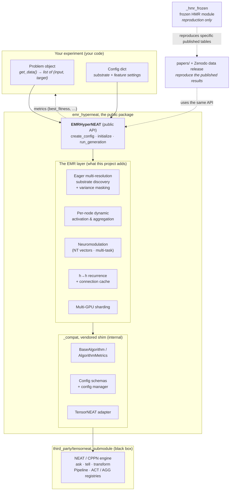

# Architecture

EMR-HyperNEAT is a **layer on top of TensorNEAT**, not a fork of it. TensorNEAT provides the
NEAT/CPPN engine (evolving a genotype network and querying it); EMR-HyperNEAT adds everything needed
to turn that engine into a fast adaptive-substrate neuroevolution system. This page explains the
layer the project adds and how the modules fit together. TensorNEAT internals are treated as a black
box that you never call directly.

## What EMR-HyperNEAT adds

ES-HyperNEAT decides *where to place neurons* by recursively subdividing space with a sequential
quadtree driven by CPPN-output variance. That quadtree is serial and CPU-bound, which caps the
method at small substrates. EMR-HyperNEAT replaces it with:

- **Eager multi-resolution substrate discovery**: a pre-computed hierarchical grid (4^(level+1)
  candidate positions per level) is evaluated all at once as batched tensor arithmetic that `vmap`s
  across the whole population, instead of one quadtree per genome.
- **Post-hoc variance masking**: after the eager evaluation, a variance threshold keeps only the
  informative positions, producing a sparse active substrate equivalent to what the quadtree would
  have found.

<p align="center">
  
</p>
<p align="center"><em>The eager grid. Candidate positions densify with depth (4, 20, 84, 340 positions at depths 1 to 4). Every position is evaluated in one batched pass, rather than being reached by sequential subdivision.</em></p>

<p align="center">
  
</p>
<p align="center"><em>Variance masking recovers the sparse substrate. The CPPN weight field (left) is reduced to per-region variance (center), and regions above threshold stay active (right), reproducing what the quadtree would have kept.</em></p>

On top of that substrate engine, the same package adds four evolvable *feature dimensions*:

- **Per-node dynamic activation functions**: each node can use a different activation, selected
  from an 18-function palette (see [configuration](configuration.md)). This is the single biggest
  lever for parity-style problems.
- **Per-node aggregation functions**: how a node combines its inputs (sum/mean/min/max/…). *Partial:
  exercised via the bio-inspired palette path (see [configuration](configuration.md)).*
- **Neuromodulation**: neurotransmitter vectors `[DA, 5HT, NE, ACh]` modulate node behavior, which
  enables one substrate to solve several tasks (multi-task).
- **Hidden-to-hidden recurrence** with a connection cache, for tasks that need memory.

Plus engineering for scale: a JIT cache, an h→h connection cache, and optional multi-GPU sharding.

## How a generation is computed

One generation takes the population from CPPN genomes to fitness values in six steps. Steps 2–4 are
the substrate discovery EMR replaces relative to ES-HyperNEAT; steps 1 and 6 are plain NEAT,
delegated to TensorNEAT.

1. **Ask.** TensorNEAT emits the generation's CPPN population and transforms each genome into
   query-ready arrays.
2. **Query the grid.** The candidate substrate is a pre-computed multi-resolution grid: level *l* is
   a `2^(l+1) × 2^(l+1)` lattice of `4^(l+1)` cells, and each level-*l* cell maps to four children at
   level *l+1* (340 candidate positions in total at `max_depth: 3`). For every (genome, source
   node, candidate position) triple the CPPN is evaluated on the input vector
   `[x1, y1, x2, y2, bias]` — a 7-input variant that adds the source→target offsets when geometry
   seeding is enabled. The whole query is one batched tensor computation `vmap`ped across the
   population; nothing is sequential per genome.
3. **Mask by variance.** Within each region of the grid, the variance of the CPPN's output field
   decides whether that region carries structure. Regions below `variance_threshold` are dropped,
   and what survives is the sparse **active set** — the substrate the sequential quadtree would have
   discovered, found by filtering the eager evaluation instead of by recursive subdivision
   (`initial_depth` can force the first levels fully active regardless of variance).
4. **Build the weight matrices.** The substrate is materialized as two dense matrices:
   `W1` with shape `(num_inputs, num_positions)` and `W2` with shape `(num_positions, num_outputs)`.
   Dense is deliberate: input→hidden and hidden→output remain GPU-efficient matmuls even though
   variance masking zeroes most positions.
5. **Evaluate.** The feedforward pass is two lines: `h = tanh(inputs @ W1)`, then
   `sigmoid(h @ W2)`. Per-node dynamic activations and aggregations replace the fixed `tanh` when
   enabled, and neuromodulation multiplies in per-node gains and gates — a *parametric* modulation
   on top of the *structural* choice the dynamic functions make; the two are orthogonal and
   composable. With recurrence, hidden→hidden is the hybrid part of the architecture: h→h
   connections are **sparse** (discovered per genome over the active set), assembled once into a
   sparse `Whh` and applied as a matmul inside `activate_time` forward iterations, while W1/W2
   stay dense.
6. **Tell.** Per-genome fitness goes back to TensorNEAT's NEAT, which selects, speciates, and
   mutates the CPPNs for the next generation.

### The recurrent path: multi-hop expansion and the h→h cache

Direct h→h connections come from thresholded CPPN queries over pairs of active positions.
`iteration_level` *k* then expands them transitively by matrix power,

```
A_total = A + decay·A² + decay²·A³ + … + decay^(k−1)·A^k
```

so that if A→B and B→C exist, an attenuated A→C is added (`hop_decay_factor` is the decay). The
expansion is JIT-compatible because *k* is a static argument — the Python loop compiles away.
Discovery is the expensive step, so it is cached at two levels: JAX's persistent compilation cache
(cross-run, keyed on shapes), and the in-run `HHCacheManager`, which skips re-discovery while the
variance mask is stable and refreshes every `hh_refresh_interval` generations or when the mask moves
by more than `hh_mask_change_threshold`.

### Why the three execution modes compute the same thing

The execution modes never change *what* is computed — only where the intermediate arrays live.
(This holds under the default `variance_rule: canonical`. Under `legacy`, which every paper
runner pins, the standard path uses the pre-0.4 level-0 subdivision rule and disagrees with the
other two — see [configuration](configuration.md).)

- **`standard`** queries every candidate position at once. Fastest, highest peak memory, and the
  path the golden tests lock.
- **`streaming`** builds the weight matrices level by level, so only one level's queries are
  resident at a time — roughly 3–10× slower per generation, and the difference between running
  depth 8+ and running out of memory.
- **`depth_offload`** additionally keeps the assembled matrices in host RAM (or a memmap) and moves
  each chunk to the device only to evaluate it. It is the only mode that reaches depth 11+, where
  the matrices exceed device memory outright.

`streaming` swaps one step inside the normal generation loop, so it composes with everything else
the loop does. `depth_offload` cannot: never materializing the full matrices means its build and its
evaluation are fused, so it replaces the generation rather than a step within it. That asymmetry is
why the dispatcher has two extension points rather than one. Knobs and auto-selection rules:
[configuration](configuration.md#execution-mode).

### What the multi-GPU strategies parallelize

Multi-GPU execution engages **only through `run_until_threshold`** (`run_generation` is
single-device by design), and only with 2+ visible devices. Each strategy answers one question:
what is split across the GPUs, and what is replicated on each?

| Strategy | Split across GPUs | Replicated per GPU | Use when |
|---|---|---|---|
| `single_gpu` | nothing | everything | one device, debugging, small runs |
| `full_pipeline_parallel` | the **dataset** | population + the full pipeline | the feedforward default. Auto-disabled when `problem.is_exhaustive_dataset` is true, because combinatorial tasks (XOR, parity) need every sample evaluated together |
| `eval_only_parallel` | evaluation samples | weights (broadcast) | recurrent/h→h runs: discovery and W1/W2 stay on one device so the h→h cache survives |
| `population_parallel_process` | the **population** (one OS process per GPU, each with its own JAX runtime) | the dataset | **not recommended.** The least exercised path here; development measurements made outside this repository found it far slower than single-device and returning zero best fitness at large populations, and they are not reproducible from this repository |
| `streaming` | data streamed CPU→GPU in chunks | — | datasets larger than combined device memory |

The parser also accepts nine older alias names and maps them onto these five:
`multi_gpu`, `data_parallel`, `pipeline_chunked` and `position_sharding_chunked` become
`full_pipeline_parallel`; `pmap_parallel` becomes `eval_only_parallel`; `cppn_chunked` becomes
`streaming`; `population_parallel_sequential` and `persistent_parallel` become
`population_parallel_process`; `baseline` becomes `single_gpu`.

Speed is deliberately absent from this table. The per-strategy ratios that used to sit in the
code's docstrings traced to a development note with no result file behind them, and later
measurements disagreed with them. Pick by the memory and correctness columns, then measure on your
own hardware.

## Component diagram



Data flows down (your problem + config → the API → the EMR layer → the shim → TensorNEAT); fitness
metrics flow back up to your loop. `_hmr_frozen` and the data release sit to the side. You only
touch them when reproducing older results.

## Module map

Everything is under `emr_hyperneat/`.

### Public: what you import and call

| Module | Role |
|---|---|
| `__init__.py` | The public surface. Exports exactly one name: `EMRHyperNEAT`. |
| `emrhyperneat.py` | The `EMRHyperNEAT` class and the feature layer: per-node dynamic activation/aggregation, neuromodulation, multi-task, the h→h cache, and the config dataclasses. Also defines `ACTIVATION_LIST` (the 18 activations) and `PALETTE_CONFIGS`. |
| `emrhyperneat_base.py` | The engine beneath the class: eager multi-resolution substrate discovery, recurrence/cache config, multi-GPU sharding, and the **TensorNEAT integration seam**. |
| `execution/` | The three execution modes — how a generation moves its intermediate arrays through memory. `ExecutionMode` and `ExecutionConfig` in `__init__.py`, memory arithmetic in `chunking.py`, and the two non-standard strategies in `streaming.py` and `offload.py`. See [Configuration](configuration.md#execution-mode). |
| `fitness_utils.py` | Ready-made fitness functions (binary / multi-class / regression) for benchmarks. |
| `multi_gpu_worker.py` | Worker processes for true multi-GPU runs (each owns its JAX runtime). Not needed for single-device use. |

You only ever construct `EMRHyperNEAT()` and call its methods (see
[Writing experiments](writing-experiments.md)).

### Internal: you do not import these directly

| Module | Role |
|---|---|
| `_compat/` | A small vendored **compatibility shim** that keeps the package self-contained: it provides `BaseAlgorithm` + `AlgorithmMetrics` (the base class and the metrics object), the Pydantic config schemas, the **TensorNEAT adapter**, and the config/parameter manager. No external framework is required. |
| `_hmr_frozen/` | A **frozen module** that some paper runners import to reproduce specific published tables exactly. It is bit-for-bit equivalent to EMR on the shared paths when EMR is pinned to `variance_rule: legacy` (the package default is `canonical`) and is not part of the public API — never call it from your own code. Which runners use it: [reproducing experiments](reproducing-experiments.md#which-experiments-use-which-engine). |
| `tests/` | The test suite (see [Testing](testing.md)), including `test_paper_validation.py`, which re-runs the simple paper experiments. |

## The TensorNEAT seam (the black box)

EMR-HyperNEAT reaches TensorNEAT through exactly two narrow seams, both inside the package internals:

1. The `_compat` **adapter** (`_compat/adapters/tensorneat_adapter.py`) builds the NEAT algorithm and
   its config and pulls TensorNEAT's activation/aggregation registries.
2. The **engine** (`emrhyperneat_base.py`) lazily imports TensorNEAT's HyperNEAT genome pieces, the
   `RecurrentGenome` (whose `forward` is the CPPN query), and the `Pipeline` driver, then JIT-compiles
   the ask/transform/tell cycle — steps 1 and 6 of [how a generation is computed](#how-a-generation-is-computed).

Everything the project adds (the eager grid, variance masking, batched CPPN queries across the
population, dynamic per-node functions, neuromodulation, and the caches) lives above this seam. You
do not need to understand NEAT or CPPNs to use EMR-HyperNEAT; you configure the substrate and the
feature dimensions, and the engine does the rest.

Next: [Writing experiments](writing-experiments.md) to use the API, or the
[configuration reference](configuration.md) for every knob.
